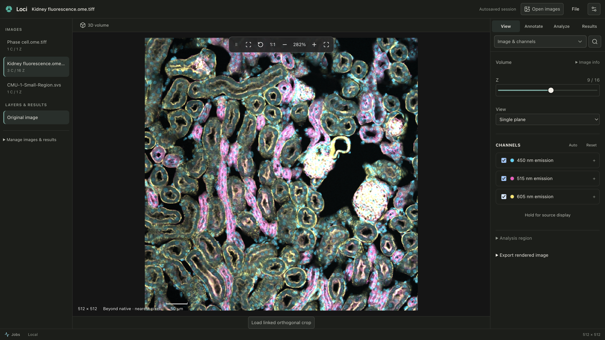
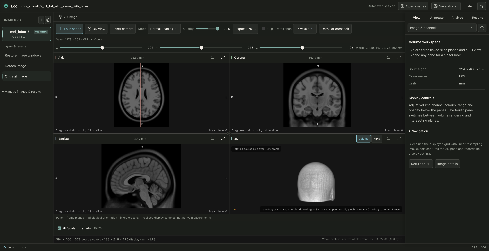
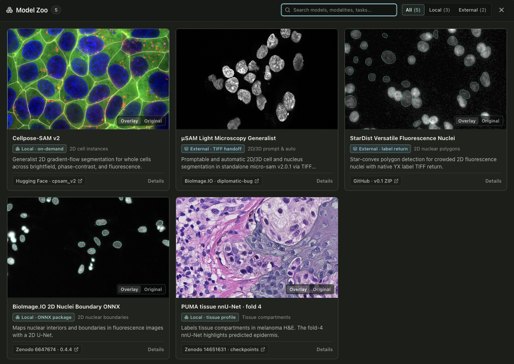

  

<h1 align="center">Loci</h1>

<strong>An open-source workbench for biomedical imaging.</strong>

  <a href="https://github.com/sidd-bme/loci-app/releases">Download for macOS</a> ·
  <a href="https://github.com/sidd-bme/loci-app/blob/main/docs/INSTALLATION.md">Install</a> ·
  <a href="https://github.com/sidd-bme/loci-app/blob/main/docs/README.md">Documentation</a> ·
  <a href="docs/MODEL_LIBRARY.md">Model Zoo</a> ·
  <a href="https://github.com/sidd-bme/loci-app/issues">Issues</a> ·
  <a href="https://ko-fi.com/lociimaging">Ko-fi</a>

Follow a structure through a fluorescence stack, outline a region on a tissue section, or measure individual cells. Loci brings the image, the analysis and the measurements into one desktop workspace. Viewing and core analysis run on your computer. Your original files stay intact, and each saved result keeps its source fingerprint, analysis settings and review history.

https://github.com/user-attachments/assets/d825ca58-b8ed-4011-83e0-a6ea6b4fe6b3

Recorded product tour (<a href="https://github.com/sidd-bme/loci-app/blob/main/docs/media/launch-credits.md">film and image credits</a>).

## Viewing and display

Open images, folders, OME-Zarr stores or a selected CT/MR DICOM series. Explore whole-slide scans (SVS and NDPI) from a tissue overview down to native detail, or move through a stack by channel, depth and time. Loci autosaves your session. Save a named `.loci-study` to return to the work without copying the original images.

Adjust channel ranges, colour maps, RGB tone curves, Z projections and pixel sampling while preserving raw measurements. Put two images side by side in **Compare A/B**, or move a view to a second display. Pan and zoom can be linked when both views share a source and grid. Drag the Images navigator into its own window, then place Display or Preprocess beside a 2D image to adjust channels or preview a processing step while you watch the specimen. For volumes, follow the same point through axial, coronal and sagittal slices alongside the 3D rendering. [Viewing guide](docs/USING_LOCI.md#view-images-and-set-display) · [Supported formats and capabilities](docs/CAPABILITY_MATRIX.md)

| Three-channel kidney fluorescence | Linked slices through the MNI ICBM152 MRI template |
| :--- | :--- |
|  |  |

## Annotations, preprocessing, and analysis

Mark points, trace freehand regions or measure tissue thickness along calibrated transects. Choose the whole image or draw an analysis region independently of the camera. In **Analyze → Preprocess**, add smoothing, background subtraction or morphology to an ordered pipeline. Select a step to edit its parameters, change its position and preview the effect on your crop. [Preprocessing guide](docs/USING_LOCI.md#preprocessing-pipeline)

Segment objects offline with thresholding, connected components or watershed. Measure fluorescence, cell shape or wound closure, track objects over time, and register images. Correct a label in a new revision, inspect which measurements changed, or compare raw intensities across samples and declared replicates. Export a figure, an object table or a scientific data package with readers for Python and R. [Object populations](docs/OBJECT_POPULATIONS.md) · [Intensity comparisons](docs/EXPERIMENT_INTENSITY.md) · [Scientific exports](docs/SCIENTIFIC_DATA_EXPORT.md)

## Model Zoo and external labels

Open **File → Model Zoo…** to browse eight microscopy profiles offline. Four examples let you slide between a specimen and its prediction. DynaCell adds local 3D virtual nuclear staining for calibrated iPSC phase images. PlantSeg and Mesmer open the label importer for results produced in those tools. Each profile links to the publisher and explains how to use its output in Loci. [Model Zoo and specimen credits](docs/MODEL_LIBRARY.md)

- **Local models.** Use Cellpose-SAM v2 to outline individual cells, the BioImage.IO 2D nuclei boundary ONNX model for fluorescence nuclei, or the PUMA fold-4 tissue nnU-Net for melanoma histology. Each uses its own local runtime and model files. [Cellpose](docs/CELLPOSE_COMPATIBILITY.md) · [ONNX packages](docs/MODEL_PACKAGE_FORMAT.md) · [PUMA tissue model](docs/TISSUE_MODELS.md)
- **External labels.** Inspect the StarDist nuclear contours on its authors’ fluorescence example. The μSAM Light Microscopy Generalist entry shows an original DAPI section. Export a native TIFF to standalone μSAM and bring the labels back to Loci, where you can check alignment and measure the underlying channel. [Standalone μSAM handoff](docs/EXTERNAL_LABELS.md#offline-standalone-μsam-interchange)

## Verified format conversion

Under **View → Import & conversion → Convert image format**, convert supported scalar TIFF, OME-TIFF, Imaris IMS and OME-Zarr series to tiled OME-TIFF or chunked OME-Zarr 0.4. Loci reopens the output, checks every pixel, and records the numeric type, channel order and calibration in `conversion.json`. [Native conversion](docs/USING_LOCI.md#convert-study-images-to-ome-tiff-or-ome-zarr)

For CZI, LIF and ND2 files, supply Bio-Formats 8.5.0 and a local JDK 11 or later for stacks. Convert a whole scalar series, a range of channels, Z planes and timepoints, or an XY crop. The verified OME-TIFF retains the original sample values and the spacing, plane times and stage coordinates reported by the reader. [Vendor conversion](docs/VENDOR_CONVERSION.md)

## Automation and workspace

- **Repeat an analysis.** Copy the verified recipe JSON from an original, native single-plane CPU Components result. Run it against the saved study with a fresh request key. The bundled `loci` CLI also supports study inspection, object queries, conversion and export. [CLI guide](docs/CLI.md) · [Replay a desktop result](docs/CLI.md#repeat-a-desktop-components-result)
- **Run a series of analyses.** Build multi-step workflows, resume a batch or send supported classical and Cellpose jobs to a configured SSH or cluster runtime. [Workflows](docs/WORKFLOWS.md) · [Remote compute](docs/REMOTE_WORKFLOW.md)
- **Connect an assistant.** Through the local Model Context Protocol (MCP) connection, choose the sources and operations an assistant can access. Inspect its plan and follow its actions in the study. [Agent access](docs/AGENT_ACCESS.md)
- **Settings and help.** Press **⌘,** (or **Ctrl+,**) to open Settings over the active image. Press **F1** for the searchable offline manual. [Settings and help](docs/USING_LOCI.md#settings-recovery-and-help)

## Getting started

On an Apple silicon Mac, install Loci and try the offline first-study walkthrough. It takes you from opening an image to reviewing a measured result. [Download](https://github.com/sidd-bme/loci-app/releases) · [Installation](https://github.com/sidd-bme/loci-app/blob/main/docs/INSTALLATION.md) · [First study](docs/workflows/FIRST_STUDY.md) · [Build from source](docs/BUILDING.md)

When publishing results, cite Loci and credit the models and datasets you used. The manual covers daily workflows, and the contributing guide explains how to report a problem or help develop the workbench. [User manual](docs/USING_LOCI.md) · [Changelog](https://github.com/sidd-bme/loci-app/blob/main/CHANGELOG.md) · [Contributing](https://github.com/sidd-bme/loci-app/blob/main/CONTRIBUTING.md)

---

[Apache-2.0](LICENSE) · [Notice](NOTICE) · [Third-party notices](THIRD_PARTY_NOTICES.md) · [Media credits](docs/media/README.md) · [Film credits](https://github.com/sidd-bme/loci-app/blob/main/docs/media/launch-credits.md) · [Security](https://github.com/sidd-bme/loci-app/blob/main/SECURITY.md)
