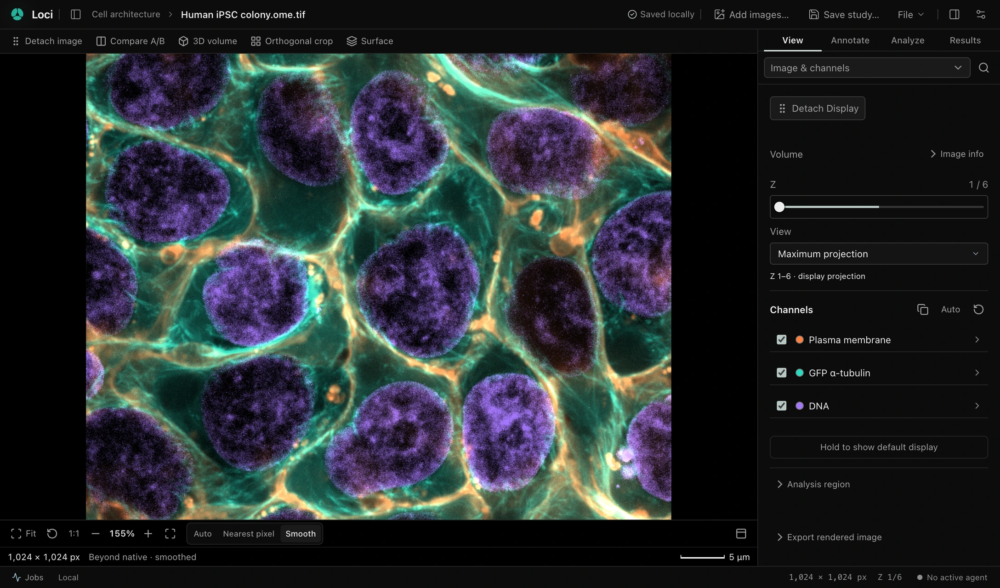

#  Loci

Loci is an open-source desktop workbench for microscopy and bioimage analysis. Explore a fluorescence stack, segment cells and follow a measurement back to the pixels it came from. Viewing and core analysis run on your computer.

[Download v0.2.0-beta.2 for Apple silicon](https://github.com/sidd-bme/loci-app/releases/tag/v0.2.0-beta.2) · [Try your first study](docs/workflows/FIRST_STUDY.md)

The Mac beta is unnotarized. The screenshots and workflows below show the current source version. [Installation and verification](docs/INSTALLATION.md)

*Six optical sections through a human iPS cell colony. A maximum-intensity projection shows plasma membrane in amber, GFP-labelled α-tubulin in aqua and DNA in violet.* [Specimen and capture credits](docs/media/README.md#current-readme)

Follow the same point through linked slices and a 3D view, or zoom from a whole-slide overview into the tissue. Adjust channel colours and contrast freely. Loci measures the raw image, keeps the original segmentation when you correct a label, and exports object tables with units and review status for use in Python or R. [Supported formats](docs/CAPABILITY_MATRIX.md) · [Scientific exports](docs/SCIENTIFIC_DATA_EXPORT.md)

The Model Zoo covers ten workflows. Run Cellpose-SAM v2 locally with its supported runtime and weights, or bring in results from other tools, including StarDist labels, CARE-restored volumes and OrganoidTracker lineages. The guide identifies which models run in Loci and gives the terms for each. [Model Zoo guide](docs/MODEL_LIBRARY.md)

## Do similar counts identify the same nuclei?

On one fluorescence image of U2OS cells, the BioImage.IO nuclei boundary model found **66** objects and thresholding with connected components found **67**. Only **56 pairs** matched at an intersection-over-union threshold of 0.50.

The ring marks model label 49. It has no matching object in the threshold result at that cutoff. Both overlays are predictions. A human reference would let you assess which better traces the nuclei. [Comparison and data credits](docs/media/README.md#current-readme)

You can ask Codex or Antigravity to make this comparison through the Model Context Protocol (MCP). Choose the image and allowed operations in Loci, then ask in your assistant’s chat. Follow the plan in Loci, inspect the model preview before approving it, and open the saved comparison to step through the disagreements. [Assistant walkthrough](docs/AGENT_ACCESS.md#compare-two-segmentation-methods-with-your-assistant) · [Host setup](docs/CLI.md#vision-assistants-and-local-mcp-access)

## Optical Section

The film moves from a light-sheet image of a mouse embryo to a recorded assistant session mapping tumor and stroma in two melanoma fields. A spatial analysis then counts lymphocytes on either side of the boundary. [Watch the film (2:04)](https://cdn.jsdelivr.net/gh/sidd-bme/loci-app@3fbe1c4cfd36f8b9cb8c199270a75d151cac3981/docs/media/optical-section.mp4) · [Download MP4 (18.6 MB)](https://github.com/sidd-bme/loci-app/raw/3fbe1c4cfd36f8b9cb8c199270a75d151cac3981/docs/media/optical-section.mp4) · [Film credits and methods](docs/media/optical-section-credits.md)

## Use and develop Loci

The public download is for Apple silicon Macs. On Windows x64, build from source using the Windows guide. [Release status](docs/RELEASE_STATUS.md) · [Windows x64 build](docs/BUILDING.md#local-windows-x64-qualification-package)

[User manual](docs/USING_LOCI.md) · [Documentation](docs/README.md) · [Build from source](docs/BUILDING.md) · [Contribute](CONTRIBUTING.md)

When citing Loci, include the release version or source commit you used and cite the models and datasets separately. [Releases](https://github.com/sidd-bme/loci-app/releases)

[Apache-2.0 licence](LICENSE) · [Notice](NOTICE) · [Third-party notices](THIRD_PARTY_NOTICES.md) · [Media credits](docs/media/README.md) · [Security](SECURITY.md)
