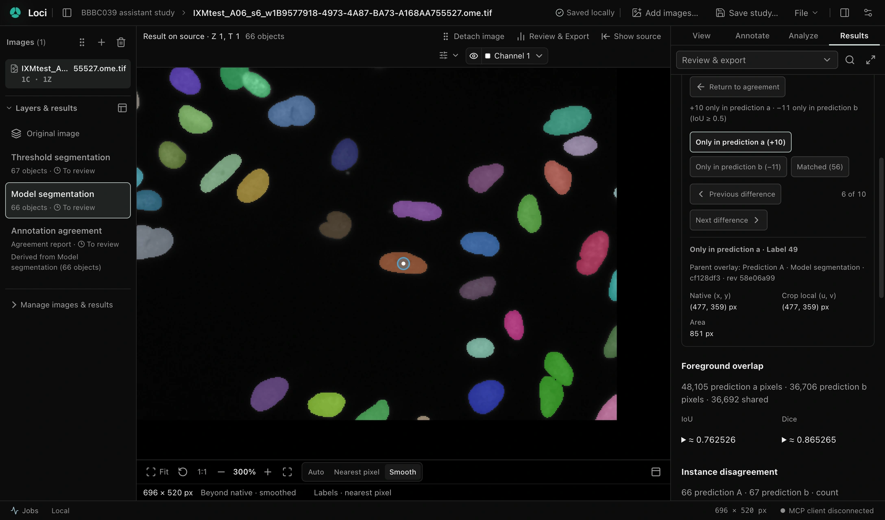
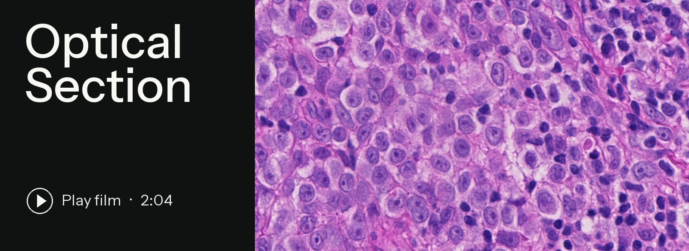

# Loci

Loci is a local-first, open-source desktop workbench for microscopy and bioimage analysis. Inspect images, measure objects and review results in the same study.

[Download v0.2.0-beta.2 for Apple silicon](https://github.com/sidd-bme/loci-app/releases/tag/v0.2.0-beta.2) · [Try your first study](docs/workflows/FIRST_STUDY.md)

The macOS pre-release is ad hoc signed and unnotarized. The installation guide covers checksums and Gatekeeper. The captures and workflows below reflect newer source builds. Windows x64 requires a source build and has no public installer. [Installation guide](docs/INSTALLATION.md) · [Release status](docs/RELEASE_STATUS.md) · [Windows x64 build](docs/BUILDING.md#local-windows-x64-qualification-package)

*Human iPS cells from BBBC034. Loci renders a native maximum-intensity projection of six acquired sections, with plasma membrane in amber, GFP-labelled α-tubulin in aqua and DNA in violet. Display adjustments leave measured values intact.* [Specimen and capture credits](docs/media/README.md#current-readme)

Follow a structure through linked 2D slices and a 3D view, then measure objects on the raw channel. Correct a label in a new revision that retains the original result. Export tables and arrays for inspection in Python or R. [User manual](docs/USING_LOCI.md) · [Scientific exports](docs/SCIENTIFIC_DATA_EXPORT.md)

The Model Zoo covers ten workflows. Run Cellpose-SAM v2 locally with its supported runtime and weights, or bring in results from external tools, including StarDist integer labels, CARE-restored volumes and OrganoidTracker lineages. [Model Zoo guide](docs/MODEL_LIBRARY.md)

## Do similar counts identify the same nuclei?

On one 696 × 520 pixel BBBC039 U2OS fluorescence field, the local BioImage.IO nuclei boundary ONNX workflow predicted 66 nuclei. Classical thresholding with connected components predicted 67. Only 56 pairs matched at intersection-over-union ≥ 0.50. The ring marks model label 49, which had no match at that threshold. This measures agreement between predictions. Assessing accuracy requires a manual reference. [Comparison and data credits](docs/media/README.md#current-readme)

To run this comparison through local MCP, ask Codex or Antigravity in its own chat after granting access to the study source and operations in Loci. Follow the plan and progress in Loci, inspect the exact model preview and approve it once to save the result. Reopen the comparison and inspect individual objects. [Assistant walkthrough](docs/AGENT_ACCESS.md#compare-two-segmentation-methods-with-your-assistant)

## Optical Section

The 2:04 film combines public microscopy, a replay of a recorded assistant session and a separate spatial analysis of melanoma tissue. [Watch the film](https://cdn.jsdelivr.net/gh/sidd-bme/loci-app@3fbe1c4cfd36f8b9cb8c199270a75d151cac3981/docs/media/optical-section.mp4) · [Download MP4 (H.264/AAC, 18.6 MB)](https://github.com/sidd-bme/loci-app/raw/3fbe1c4cfd36f8b9cb8c199270a75d151cac3981/docs/media/optical-section.mp4) · [Film credits and methods](docs/media/optical-section-credits.md)

## Develop and cite

[Documentation](docs/README.md) · [Build from source](docs/BUILDING.md) · [Contribute](CONTRIBUTING.md)

When citing Loci, include the release version or source commit you used and cite the models and datasets separately. [Releases](https://github.com/sidd-bme/loci-app/releases)

[Apache-2.0 licence](LICENSE) · [Notice](NOTICE) · [Third-party notices](THIRD_PARTY_NOTICES.md) · [Media credits](docs/media/README.md) · [Security](SECURITY.md)
