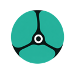
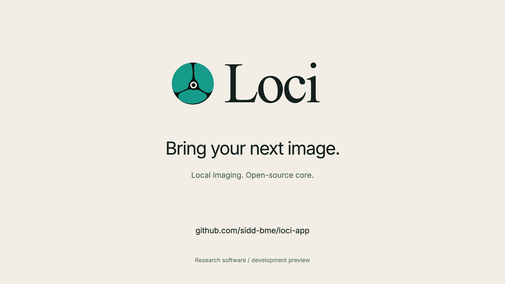
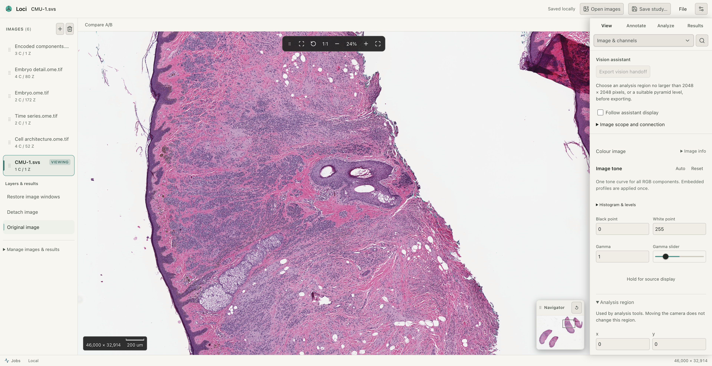
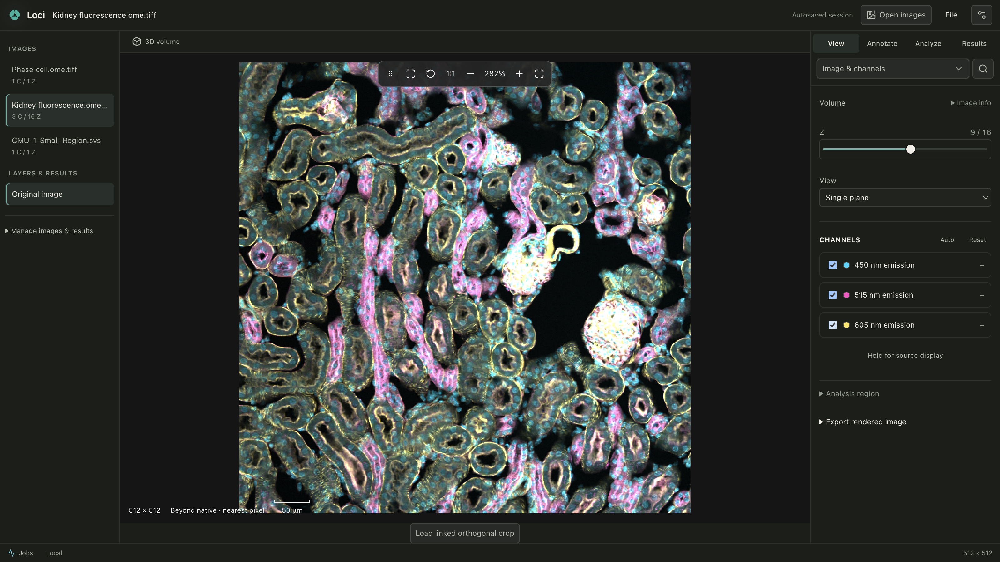
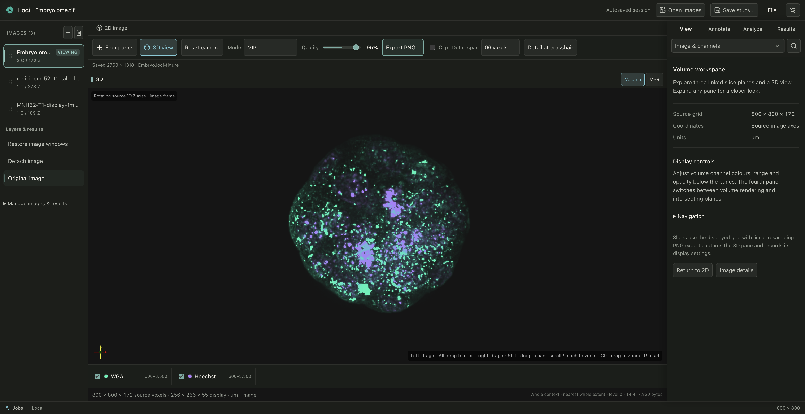
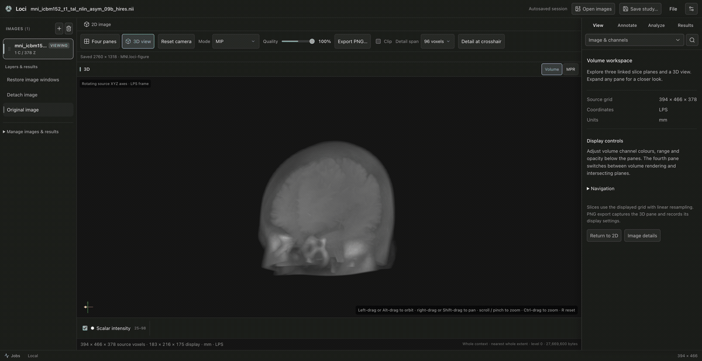
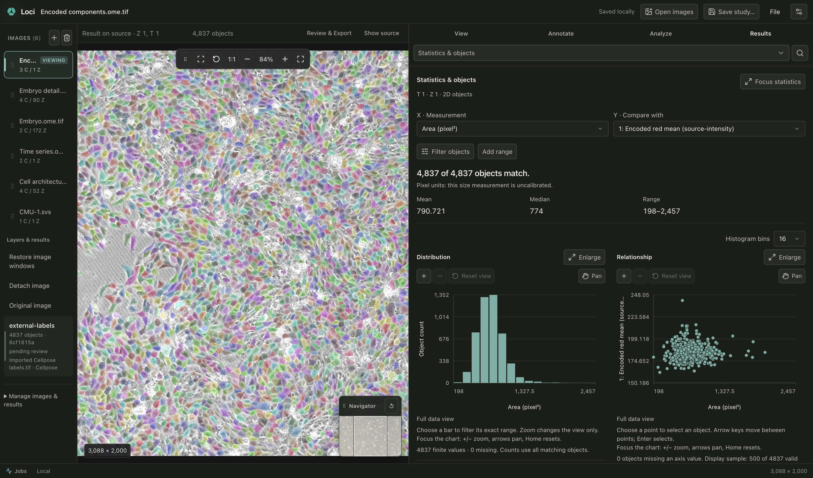
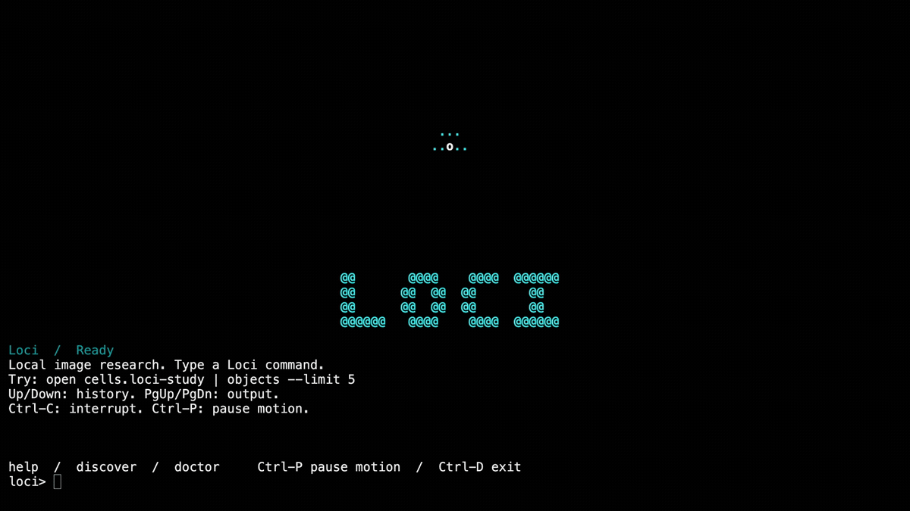
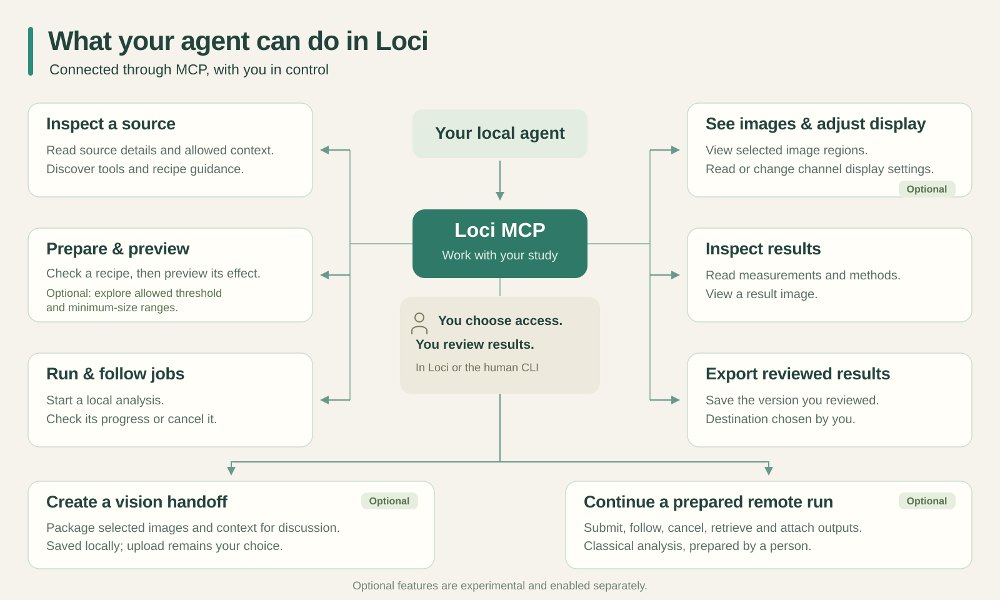

  

<h1 align="center">Loci</h1>

<strong>Bring your next image.</strong>

A local workspace for microscopy, image analysis and the questions in between.

  <a href="https://github.com/sidd-bme/loci-app/releases/tag/v0.2.0-beta.1">Download for macOS</a> ·
  <a href="docs/README.md">Documentation</a> ·
  <a href="https://github.com/sidd-bme/loci-app/issues">Feedback</a> ·
  <a href="https://ko-fi.com/lociimaging">Support on Ko-fi</a>

<a href="https://github.com/sidd-bme/loci-app/releases/download/v0.2.0-beta.1/Loci-film-1080p60.mp4">▶ Watch the 74-second tour</a>

Loci brings your images, measurements and analysis tools into one desktop workspace. Move from a tissue overview to individual cells, explore a volume, refine a segmentation, and keep the results connected to the image they came from.

Your original data stays intact. Core viewing and analysis run on your computer, with no account or cloud service required.

## See the whole picture

Open microscopy images, whole-slide scans and 3D volumes. Navigate channels, depth and time, then set the colours and contrast that make the structures you care about easier to see.

| Follow your channels | Explore in three dimensions |
| :--- | :--- |
|  |  |
| Adjust each channel without changing the source pixels. | Rotate a volume and tune its colour and opacity. |

### Connect the slices

Linked orthogonal views keep a point in context across the volume. Inspect the planes alongside a 3D view and move between them as you explore.

## From objects to answers

Bring your own model and keep the rest of your workflow in one place. Use a [compatible local model](docs/MODEL_PACKAGE_FORMAT.md), a configured Cellpose profile, or import labels from another segmentation tool. Inspect individual objects, filter their measurements, refine labels, and compare distributions in the statistics workspace. Save a study when you pause and return with the images, settings and results together.

*4,837 imported Cellpose objects, with measurements and distributions linked to the source image.*

- **Measure in context.** Draw regions and annotations, inspect object measurements, and keep calibration and units alongside the results.
- **Review and refine.** Edit labels, compare correction effects, and choose the results you want to export.
- **Build a repeatable workflow.** Save recipes, run batches, and use the command line or local MCP connection for supported automation.
- **Share the result.** Export tables, rendered figures and portable studies.

## Work your way

Use the desktop for exploration and the command line for repeatable work. Discover commands, inspect a study and run supported operations from a local terminal.

### Connect your agent

Give a local agent access to the images and operations you choose. Through MCP, it can inspect sources, prepare and run approved recipes, follow jobs, and read results. You stay in charge of access and review.

[Set up agent access](docs/AGENT_ACCESS.md) · [Explore the CLI](docs/CLI.md)

## Start a study

**[Download the development beta for Apple Silicon Macs](https://github.com/sidd-bme/loci-app/releases/tag/v0.2.0-beta.1)**, follow the **[installation guide](docs/INSTALLATION.md)**, then **[open your first image](docs/workflows/FIRST_STUDY.md)**.

This beta is unnotarized, so macOS requires an explicit first-launch approval. Model weights are supplied separately. The guides cover both steps.

| Learn | Make it your own |
| :--- | :--- |
| [User manual](docs/USING_LOCI.md) | [Command line](docs/CLI.md) |
| [Formats and capabilities](docs/CAPABILITY_MATRIX.md) | [Local agent and MCP access](docs/AGENT_ACCESS.md) |
| [Analysis workflows](docs/WORKFLOWS.md) | [Build from source](docs/BUILDING.md) |
| [What's new](CHANGELOG.md) | [Contribute](CONTRIBUTING.md) |

## Looking ahead

- More ways to bring your own segmentation models.
- Broader 3D segmentation capabilities.
- Local model training and comparison.
- Windows support and easier installation.

These are directions for future work.

## Made for everyday research

Loci started with a practical cell-counting workflow. It is growing into the imaging workspace I wanted to use: approachable enough for a quick look, with room to follow an analysis further.

Found a rough edge, have a workflow in mind, or want to help? [Open an issue](https://github.com/sidd-bme/loci-app/issues). If Loci is useful to you, [supporting it on Ko-fi](https://ko-fi.com/lociimaging) helps keep the project moving.

---

[Apache-2.0](LICENSE) · [Image and film credits](docs/media/README.md) · [Third-party notices](THIRD_PARTY_NOTICES.md) · [Security](SECURITY.md)

Research software in active development; not intended for clinical diagnosis.
