#  Loci

Loci is an open-source desktop workbench for biomedical imaging. Explore optical sections, segment cells and measure tissue on your own computer. Trace a measurement back to its source image, analysis settings and review history.

[Download the Apple silicon beta](https://github.com/sidd-bme/loci-app/releases/tag/v0.2.0-beta.2) · [Interactive product tour](https://sidd-bme.github.io/loci-app/) · [Try your first study](docs/workflows/FIRST_STUDY.md) · [Installation and checksum verification](docs/INSTALLATION.md)

The download is the unnotarized **v0.2.0-beta.2** prerelease. This tour shows the newer development build. [Release status](docs/RELEASE_STATUS.md)

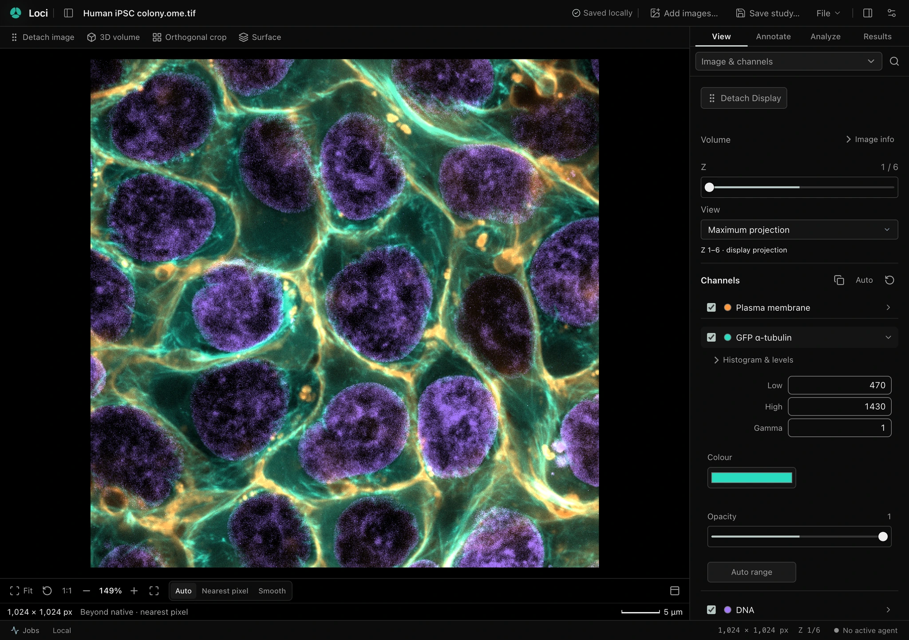

Six optical sections of an Allen Institute human induced pluripotent stem cell (iPSC) colony, combined in a maximum-intensity projection. Plasma membrane appears in amber, GFP-labelled α-tubulin in aqua and DNA in violet. [Specimen and capture credits](docs/media/tour/README.md#fluorescence-and-cell-measurements)

[Image views](#image-views) · [Measurement and review](#measurement-and-review) · [Model Zoo](#model-zoo) · [Assistant connection](#assistant-connection) · [Command line](#command-line) · [Film](#watch-optical-section) · [Installation and documentation](#installation-and-documentation)

## Image views

Step through a Z stack one optical section at a time, or summarize a selected Z range with a maximum- or mean-intensity projection. Set channel visibility, colour and contrast independently of the raw values used for measurement. Use **Compare A/B** for a side-by-side view, or detach the viewer and keep its controls on a second display. [Display and navigation guide](docs/USING_LOCI.md#view-images-and-set-display)

### Confocal stacks in 3D

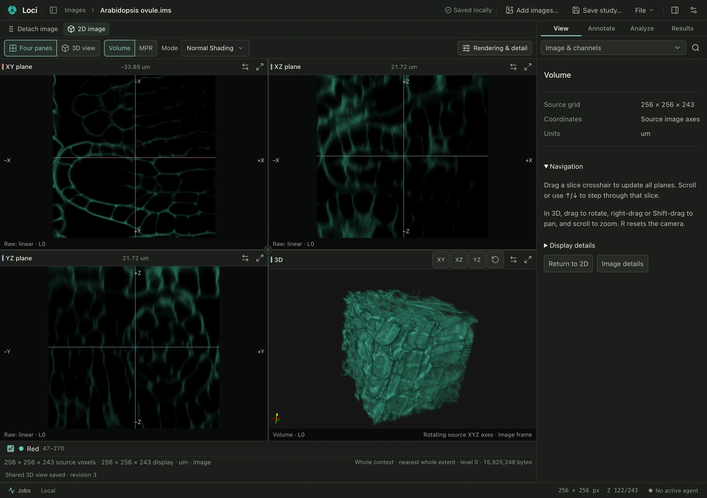

This 256 × 256 × 243 confocal volume of a wild-type *Arabidopsis thaliana* ovule is open directly from its Imaris IMS file. Normal shading brings out structure in the acquired intensity data. In the 3D pane, orbit freely or select **XY**, **XZ** or **YZ** to look along a source axis. Snapping or resetting the camera keeps the crosshair on the same voxel in all three sections. [Volume and multiplanar views](docs/USING_LOCI.md#inspect-scalar-volumes-and-mpr)

### Whole-slide brightfield

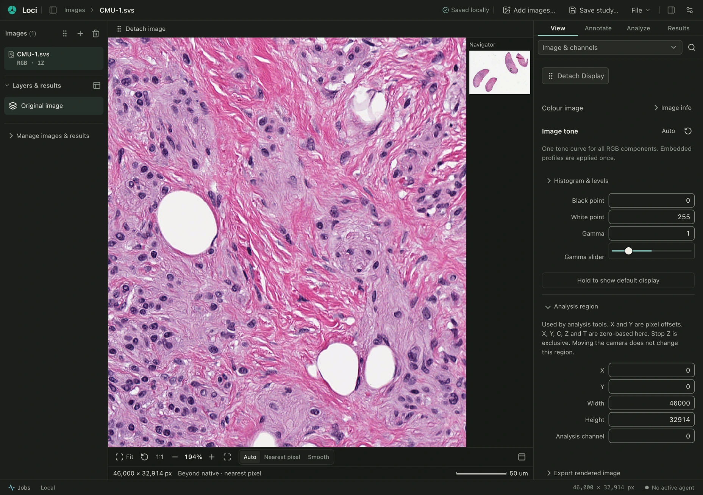

Zoom from the overview of the 46,000 × 32,914 pixel Aperio CMU-1 slide to a level-zero region. The Navigator keeps the field in context as you move. Save regions of interest against the slide’s native coordinates for later inspection. [Whole-slide formats and analysis limits](docs/WHOLE_SLIDE_SUPPORT.md)

### Linked medical planes

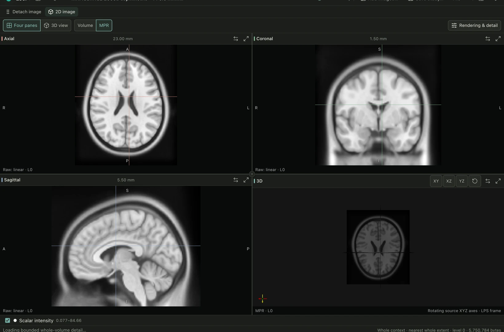

Moving the crosshair in one plane locates the same position in the others. This population-average ICBM152 T1 MRI is a NIfTI volume with 0.5 mm isotropic spacing. The physical orientation and millimetre coordinates come from the source geometry. [Medical research formats](docs/USING_LOCI.md#medical-research-sources)

### Time series and lineage

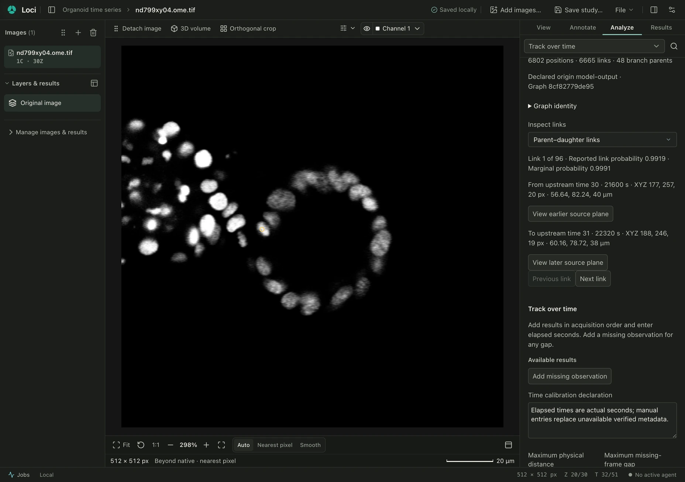

Play the 51-frame organoid movie and inspect the source at either endpoint of an imported track link. This OrganoidTracker 2.0 example contains 6,802 detections and 6,665 links, with 48 candidate division parents. Loci retains the external graph’s link and marginal probabilities separately so you can check the evidence for a link against the original Z sections. [Lineage import and inspection](docs/ORGANOIDTRACKER.md)

### Quantitative phase microscopy

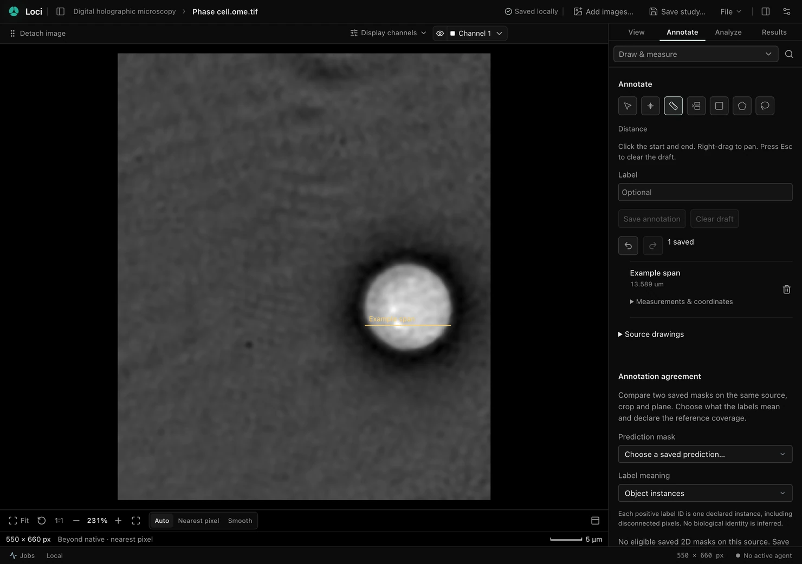

In this calibrated digital holographic image, the saved line spans **13.589 µm** between two points selected with **Draw & measure**. [Source and calibration](docs/media/tour/README.md#image-modes) · [Source-bound annotations](docs/USING_LOCI.md#draw-source-bound-annotations)

## Measurement and review

### Go from labels to measurements

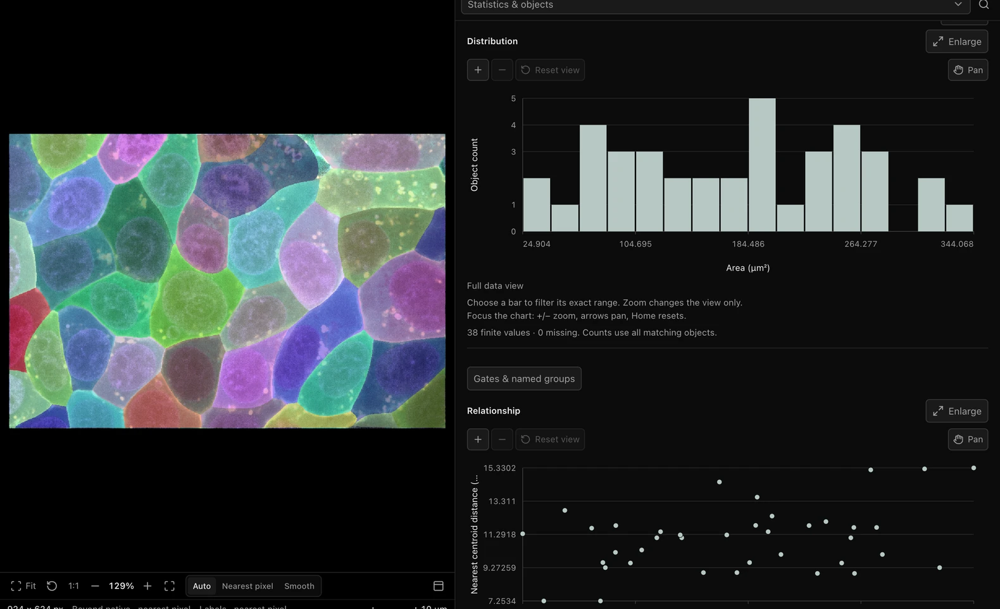

In a second iPSC field, Cellpose-SAM v2 predicted 38 whole cells from a windowed three-channel RGB input at source Z40. The labels were imported on the original XY grid. Loci used the native calibration and scalar measurement channel to measure the labelled objects. Explore cell area (µm²) and nearest-centroid spacing (µm), filter the population and locate any matching label in the source field. [External labels](docs/EXTERNAL_LABELS.md) · [Object populations](docs/OBJECT_POPULATIONS.md)

### Check where segmentation methods disagree

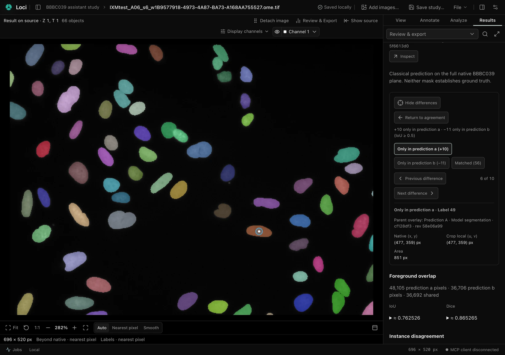

On one BBBC039 U2OS field, the BioImage.IO nuclei model produced **66** objects and classical connected components produced **67** (raw threshold 520, minimum area 20 pixels). At intersection-over-union ≥ 0.50, **56 pairs** matched, with 10 model-only and 11 threshold-only objects. The ring identifies model label 49, an unmatched object with an area of 851 px². This is a comparison between predictions on one field. Accuracy requires an independent reference. [Source and model credits](docs/media/tour/README.md#fluorescence-and-cell-measurements)

### Export individual channels and their merge

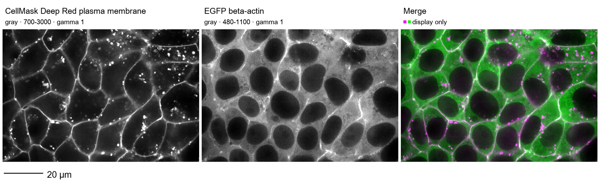

This figure shows plasma membrane and β-actin from the same native section. In **Display → Export rendered image**, choose grayscale channels and a merge, then set a row or column layout. Loci includes the display windows and can add a calibrated scale bar to the PNG or 16-bit rendered TIFF. Quantitative measurements still use the original channel values. [Channel figures](docs/CHANNEL_FIGURES.md) · [Source credit](docs/media/tour/README.md#fluorescence-and-cell-measurements)

### Repeat an analysis and keep its history

- **Set the scope.** Declare the region, native channels, time point and Z range before running a method. Draw ROIs, run thresholding or watershed, measure puncta and channel intensity, or measure cell density in distance bands along a tissue boundary. Record a transform when registering images to a common grid. [Quantification](docs/QUANTIFICATION.md) · [Spatial distance bands](docs/SPATIAL_DISTANCE_BANDS.md) · [Registration](docs/REGISTRATION.md)
- **Reuse the method.** Set up processing, segmentation and measurement in the Workflow builder, preview a step and repeat a saved recipe across compatible study images. Run supported batch jobs locally or use an explicitly configured remote profile for eligible jobs. [Visual workflows](docs/WORKFLOWS.md) · [Remote compute](docs/REMOTE_WORKFLOW.md)
- **Review and export.** Correct a label in a new revision and revisit the parent when needed. Review the exact revision you intend to share. Reviewed result bundles can include OME-TIFF labels, CSV measurement tables, geometry, settings and review history. Scientific data tables for selected result revisions have Python and R readers. [Result review and export](docs/USING_LOCI.md#inspect-provenance-review-and-export-one-result) · [Scientific data packages](docs/SCIENTIFIC_DATA_EXPORT.md)

## Model Zoo

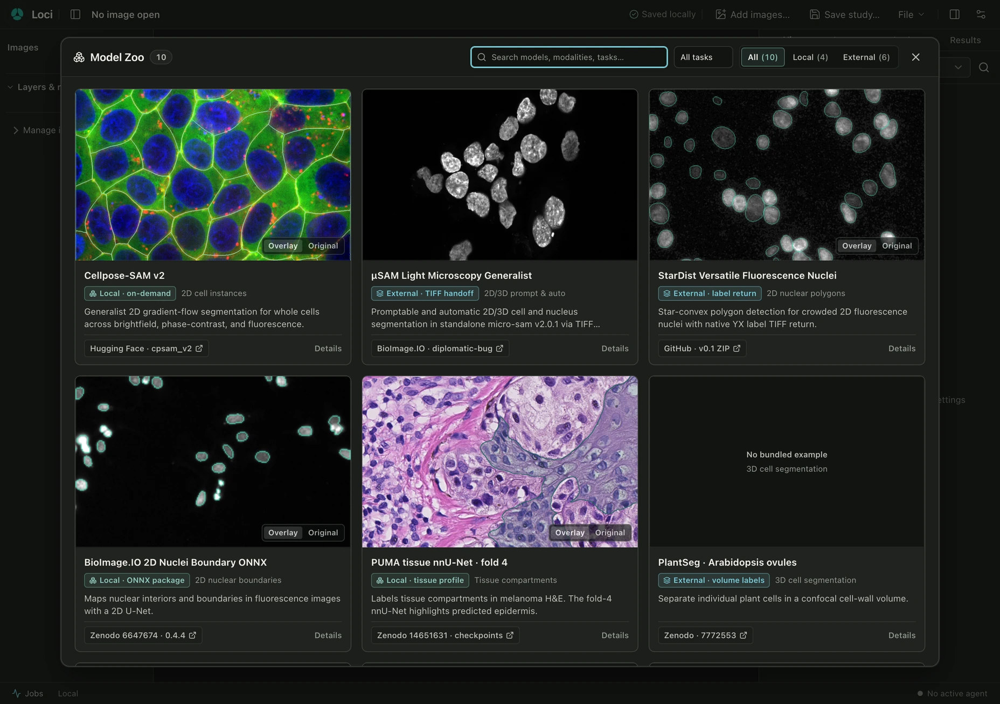

Browse ten workflows in **File → Model Zoo…**. Filter by task or execution location and inspect the original image and prediction wherever a paired example is available.

- **Local.** Set up Cellpose-SAM v2, the BioImage.IO 2D nuclei boundary ONNX model or PUMA’s tissue nnU-Net profile with its supported runtime and weights. DynaCell predicts a normalized nuclear signal on compatible reconstructed Phase3D volumes of unperturbed WTC-11 iPSCs.
- **External.** Bring in instance labels from μSAM, StarDist, PlantSeg or Mesmer, a separately restored CARE volume, or an OrganoidTracker 2.0 `.aut` v1 graph. [Inputs, runtime requirements and licence terms for each workflow](docs/MODEL_LIBRARY.md)

## Assistant connection

Choose **Codex** or **Antigravity** in **Connect an assistant** and select the image, region, channels and operations to share. On macOS, **Open in Codex** opens the study workspace in the installed app. For Antigravity, copy the workspace path and add that folder to a new project. Send the first prompt in the host chat and use **Check connection** in Loci to see which client connected. The Model Context Protocol (MCP) server runs locally. Your host and its provider can receive the image content and study records you authorize. [Host setup](docs/CLI.md#vision-assistants-and-local-mcp-access)

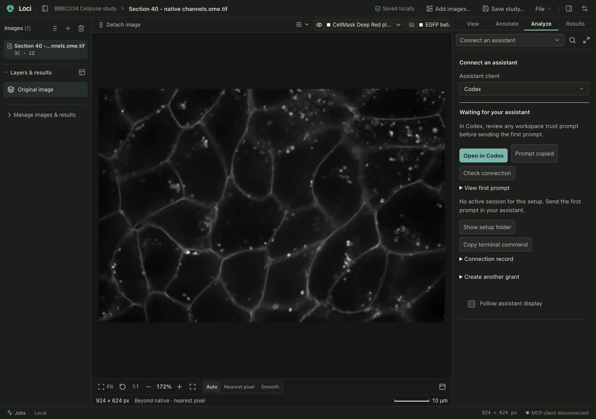

**Find cells in one channel and measure another.** In this 256 × 256 pixel crop, Cellpose-SAM v2 predicted six objects from the membrane channel. The assistant requested per-object measurements from the raw β-actin channel. Inspect the boundaries in Loci before approving the save. A later correction keeps the original mask and remeasures the revised objects. [Multichannel assistant walkthrough](docs/AGENT_ACCESS.md#find-cells-in-one-channel-and-measure-another)

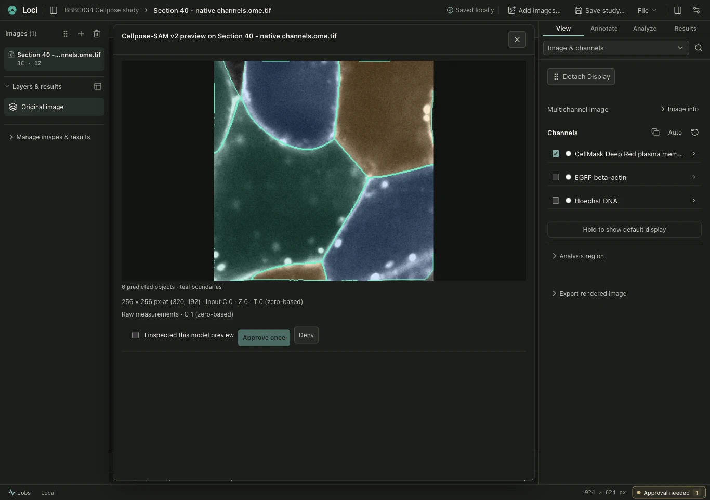

**Agent workspace** keeps the plan beside the image. For the nuclei comparison, open the exact model preview before approving a save. After disconnecting, use the plan’s evidence links to reopen a result or inspect its assessment. For 3D work, you can also grant the assistant access to move the crosshair or camera in the live viewer. [Shared 3D scene controls](docs/AGENT_ACCESS.md#shared-3d-scene-access)

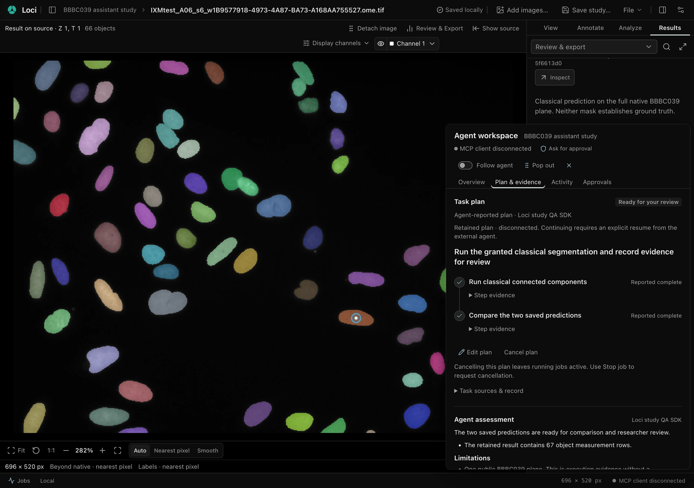

This retained BBBC039 plan comes from an MCP test client run. The classical result contains 67 measurement rows. [Capture provenance](docs/media/tour/README.md#workflows)

## Command line

Use the `loci` command to inspect a saved study from a terminal. The same 38-cell result above was queried by area and nearest-centroid spacing. The first command found 19 matches and printed three. The second located label 4 at zero-based row **Y=91**, column **X=346**.

```sh
loci objects --project colony.loci-study --area 120:350 --spacing 10:40 --limit 3
loci locate 4 --project colony.loci-study
```

Save your own study and substitute its path and measurement bounds. The example uses µm² for area and µm for spacing. [CLI setup and object queries](docs/CLI.md#inspect-measured-objects)

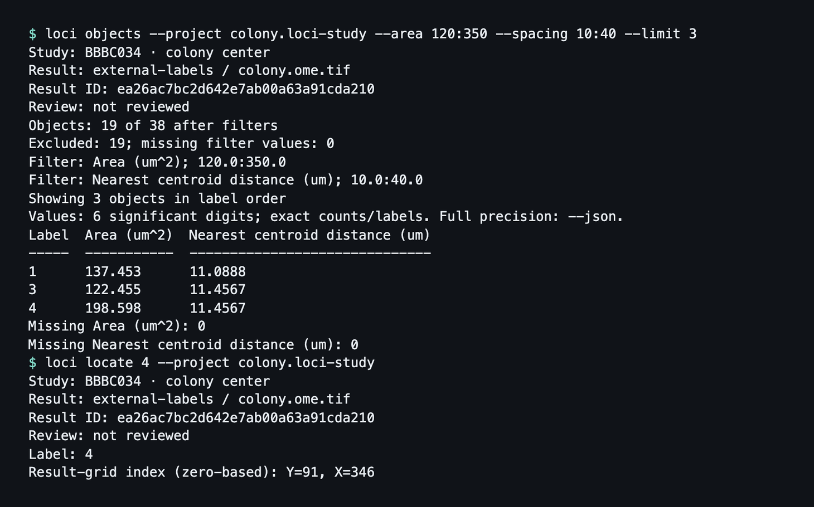

## Watch Optical Section

*Optical Section* follows a light-sheet embryo volume, an assistant session on two H&E melanoma fields and a spatial analysis of lymphocytes relative to a tissue boundary. [Watch the film (2:04)](https://cdn.jsdelivr.net/gh/sidd-bme/loci-app@3fbe1c4cfd36f8b9cb8c199270a75d151cac3981/docs/media/optical-section.mp4) · [Download MP4 (18.6 MB)](https://github.com/sidd-bme/loci-app/raw/3fbe1c4cfd36f8b9cb8c199270a75d151cac3981/docs/media/optical-section.mp4) · [Film credits and methods](docs/media/optical-section-credits.md)

## Installation and documentation

The public Apple silicon beta comes with checksums. Verify the ZIP, unzip it and move `Loci.app` to Applications. If macOS blocks the first launch, use the documented steps in Privacy & Security. Windows x64, Linux and Intel Mac installers are unavailable for this prerelease. For current source features, follow the build guide. [Install the beta](docs/INSTALLATION.md) · [Build from source](docs/BUILDING.md) · [Windows x64 build](docs/BUILDING.md#local-windows-x64-qualification-package)

- **Microscopy.** Open supported TIFF, BigTIFF, OME-TIFF, Imaris IMS, local OME-NGFF 0.4 / Zarr v2 stores, or single-frame PNG and JPEG. [Native formats and limits](docs/CAPABILITY_MATRIX.md)
- **Whole slides and research volumes.** Open supported Aperio SVS and Hamamatsu NDPI slides, scalar NIfTI and NRRD images, or conventional CT/MR DICOM series. [Slide support](docs/WHOLE_SLIDE_SUPPORT.md) · [Medical source formats](docs/USING_LOCI.md#medical-research-sources)
- **Vendor microscopy files.** Convert a supported selection from a CZI, ND2 or LIF series to OME-TIFF with the documented Bio-Formats runtime. [Vendor conversion](docs/VENDOR_CONVERSION.md)

[First study](docs/workflows/FIRST_STUDY.md) · [User manual](docs/USING_LOCI.md) · [Documentation index](docs/README.md) · [Contribute](CONTRIBUTING.md)

Loci’s core is licensed under Apache-2.0. When citing Loci, include the release version or source commit and cite the datasets and models you used separately. [Releases](https://github.com/sidd-bme/loci-app/releases) · [Tour credits](docs/media/tour/README.md) · [Media archive](docs/media/README.md)

[Licence](LICENSE) · [Notice](NOTICE) · [Third-party notices](THIRD_PARTY_NOTICES.md) · [Security](SECURITY.md)
